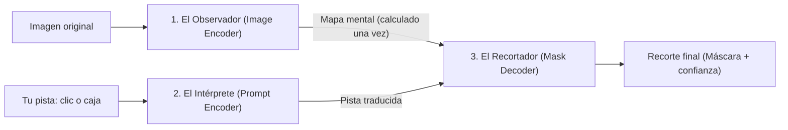
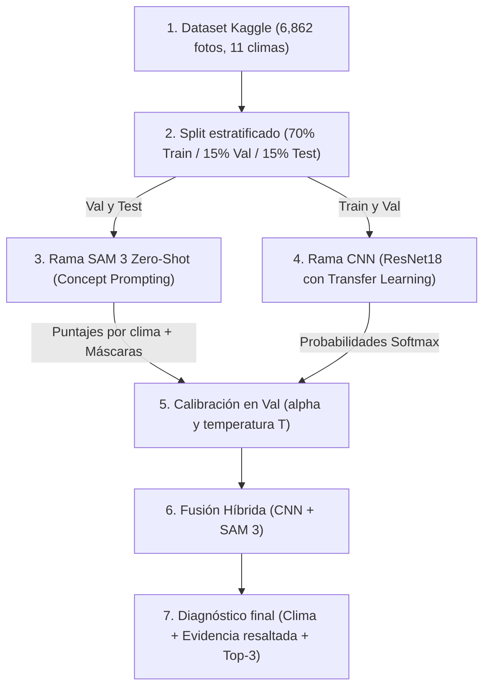
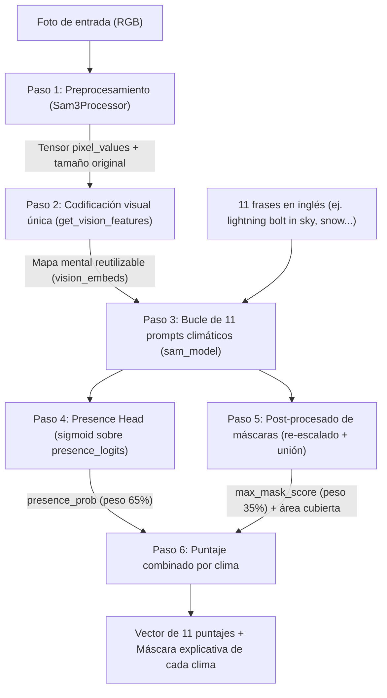

# Segment Anything Model (SAM) — Guía Comprensiva

Bienvenido a este repositorio. Antes de pasar al código y a nuestro ejemplo práctico, esta guía explica de forma clara, completa y sin jerga innecesaria **qué es SAM (Segment Anything Model)**, **por qué es importante** y **cómo funciona por dentro**.

---

## 1. ¿Qué es SAM en palabras sencillas?

**SAM** (siglas en inglés de *Segment Anything Model*, o *"Modelo para Segmentar Cualquier Cosa"*) es un sistema de Inteligencia Artificial creado por **Meta AI** diseñado para **identificar y recortar con precisión cualquier objeto dentro de una imagen**.

Si tuviéramos que describirlo con una analogía cotidiana, SAM funciona como unas **tijeras mágicas inteligentes**: le muestras una fotografía, señalas algo con un clic (o dibujas un recuadro a su alrededor) y el modelo separa exactamente ese objeto del resto de la escena, borde por borde, en cuestión de milisegundos.

Lo más sorprendente es que **no necesita haber visto ese tipo de objeto antes** para poder recortarlo bien. Puede recortar desde un perro o un automóvil hasta una herramienta rara, una célula bajo un microscopio o una piedra en el fondo del mar.

---

## 2. ¿Qué significa "segmentar" una imagen?

En el mundo de la visión por computadora (la rama de la IA que enseña a las máquinas a "ver"), existen distintos niveles de detalle para entender una foto:

| Tarea | ¿Qué responde? | Ejemplo en una foto con un gato en un sofá |
| :--- | :--- | :--- |
| **Clasificación** | *¿Qué hay en la foto?* | "En esta imagen hay un gato." |
| **Detección de objetos** | *¿Dónde está aproximadamente?* | Dibuja un rectángulo alrededor del gato. |
| **Segmentación** | *¿Qué píxeles exactos pertenecen al objeto?* | Pinta únicamente la silueta exacta del gato, siguiendo sus orejas, bigotes y cola, sin tocar el sofá. |

El resultado de la segmentación se llama **máscara**: una especie de "plantilla" o "silueta" que indica exactamente qué parte de la imagen corresponde al objeto elegido y qué parte corresponde al fondo.

---

## 3. ¿Por qué SAM marcó un antes y un después?

Antes de que existiera SAM, crear una IA capaz de recortar objetos era un proceso lento y muy rígido:

* **El enfoque tradicional (especialistas rígidos):** Si querías un programa que recortara bicicletas, tenías que reunir miles de fotos de bicicletas, pedirle a personas que trazaran manualmente el borde de cada una y entrenar un modelo solo para eso. Si al día siguiente querías recortar tazas de café, ese modelo no servía: había que repetir el trabajo desde cero.
* **El enfoque de SAM (un modelo generalista):** En lugar de memorizar listas cerradas de objetos ("perro", "auto", "silla"), SAM aprendió el **concepto general de qué hace que algo sea un objeto**: cómo se comportan los bordes, las sombras, las texturas, las formas y la profundidad.

Gracias a esto, SAM tiene una capacidad llamada ***Zero-Shot*** (aprendizaje sin ejemplos previos): puedes mostrarle una foto de un objeto totalmente nuevo que jamás apareció en su entrenamiento y aun así sabrá exactamente dónde empieza y dónde termina.

---

## 4. ¿Cómo te comunicas con SAM? (Las indicaciones o *Prompts*)

Así como a un asistente de texto le das instrucciones escribiendo una pregunta, a SAM le das **pistas visuales** (llamadas *prompts*) para decirle qué te interesa recortar:

1. **Con un clic (puntos):**
   * **Punto positivo:** *"Recorta el objeto que está justo aquí."*
   * **Punto negativo:** *"Pero excluye esta parte"* (muy útil si el recorte incluyó algo extra que no querías).
2. **Con una caja (rectángulo):** Dibujas un recuadro rápido alrededor del objeto y SAM ajusta el recorte exactamente a su silueta real.
3. **Con un trazo aproximado:** Puedes darle una silueta borrosa o incompleta y SAM la pule hasta dejar los bordes limpios.
4. **Modo automático ("todo a la vez"):** Si no le das ninguna pista, SAM puede escanear toda la fotografía por su cuenta y separar automáticamente cada objeto que detecte, como si desmontara la foto en piezas de un rompecabezas.

---

## 5. ¿Cómo funciona SAM por dentro?

Aunque por detrás usa redes neuronales avanzadas, su arquitectura se puede entender fácilmente como un **equipo de tres especialistas** que trabajan en cadena:



### Paso 1: El Observador de Imágenes (*Image Encoder*)
Es el especialista que realiza el trabajo pesado. Mira la imagen completa una sola vez y construye un **"mapa mental"** muy detallado (técnicamente llamado *embedding*) donde resume formas, colores, contornos y relaciones entre partes de la foto.

* **¿Por qué esto es inteligente?** Porque este análisis profundo **solo se hace una vez por imagen**. Una vez creado el mapa mental, puedes hacer 10, 20 o 50 clics distintos sobre la misma foto sin tener que volver a analizarla desde cero.

### Paso 2: El Intérprete de Pistas (*Prompt Encoder*)
Mientras tú haces clic en un punto o dibujas un rectángulo, este especialista toma tu indicación y la traduce al mismo "idioma matemático" en el que está escrito el mapa mental de la imagen. Es un proceso prácticamente instantáneo.

### Paso 3: El Recortador Instantáneo (*Mask Decoder*)
Este especialista junta dos cosas: el mapa mental del Observador y tu pista traducida por el Intérprete. Con esa combinación, decide en milisegundos qué píxeles forman el objeto que señalaste y genera la **máscara** (el recorte final).

---

### ¿Qué pasa cuando una pista es ambigua?

Imagina que en una foto de una persona haces clic sobre su camisa. ¿Qué quieres recortar realmente?
* ¿Solo el botón donde cayó el clic?
* ¿La camisa completa?
* ¿A la persona entera?

Un sistema rígido tendría que adivinar y se equivocaría dos de cada tres veces. SAM resuelve esto de una manera muy natural: **propone varias opciones a la vez** (normalmente 3 niveles: un detalle pequeño, una parte mediana y el objeto completo) y acompaña cada propuesta con una **puntuación de confianza** que indica qué tan seguro está de que ese recorte tiene sentido.

---

## 6. ¿Cómo logró SAM aprender tanto?

Para dominar el arte de recortar cualquier cosa, SAM necesitaba practicar con una cantidad gigantesca de ejemplos. Meta creó un ciclo de entrenamiento llamado **Motor de Datos (*Data Engine*)** que evolucionó en tres etapas:

1. **Etapa asistida por humanos:** Al principio, personas reales recortaban objetos en fotografías con una ayuda básica del modelo, corrigiendo sus errores. Cada corrección hacía al modelo más preciso.
2. **Etapa semiautomática:** Cuando SAM mejoró, comenzó a recortar automáticamente los objetos más evidentes, mientras los humanos se enfocaban únicamente en los objetos difíciles o pequeños para enseñar al modelo a pulir sus fallas.
3. **Etapa totalmente automática:** Finalmente, SAM se volvió tan capaz que pudo analizar millones de fotografías por su cuenta y generar recortes de alta calidad sin intervención humana.

El resultado fue **SA-1B**, una biblioteca masiva de entrenamiento con **más de 11 millones de imágenes y más de 1.100 millones de recortes (máscaras)**, una escala cientos de veces mayor que la de bases de datos anteriores.

---

## 7. ¿Para qué se usa SAM en la vida real?

La capacidad de aislar objetos con facilidad tiene aplicaciones prácticas en muchísimas áreas:

* **Edición de fotos y diseño:** Eliminar fondos en un clic, cambiar el color de una prenda, borrar personas u objetos no deseados, o aplicar desenfoques selectivos.
* **Medicina e imágenes clínicas:** Ayudar a especialistas a delimitar órganos, tejidos o posibles anomalías en radiografías, resonancias o tomografías (siempre como herramienta de apoyo).
* **Agricultura y medio ambiente:** Analizar fotos de drones o satélites para medir hectáreas de cultivo, contar árboles, detectar zonas inundadas o mapear techos y edificios.
* **Robótica y vehículos autónomos:** Ayudar a un robot a distinguir exactamente dónde termina una caja que debe recoger, o a un vehículo a separar la carretera, los peatones y las señales.
* **Ciencia y biología:** Contar células bajo un microscopio, seguir fauna en cámaras de naturaleza o analizar partículas en laboratorio.

---

## 8. Evolución: SAM 1 vs. SAM 2 vs. SAM 3

Desde su lanzamiento original, Meta ha evolucionado SAM en tres generaciones muy claras:

| Versión | Qué analiza | Cómo le das instrucciones | Gran avance |
| :--- | :--- | :--- | :--- |
| **SAM 1** | Solo imágenes | Clics, cajas y máscaras | Primer recortador universal *Zero-Shot* para cualquier objeto en una foto. |
| **SAM 2** | Imágenes y **videos** | Clics, cajas y máscaras | Añadió memoria temporal para seguir un objeto frame a frame en video aunque se mueva o se oculte brevemente. |
| **SAM 3** | Imágenes y videos | **Texto**, ejemplos visuales, clics, cajas y máscaras | Entiende **conceptos en lenguaje natural** (ej. *"rayo"*, *"nieve"*, *"casco amarillo"*), encuentra **todas las instancias** a la vez y verifica si el objeto realmente existe (*Presence Head*) para reducir falsos positivos. |

---

## 9. Qué hace y qué NO hace SAM (Limitaciones importantes)

Para usar SAM correctamente, es muy importante entender sus límites:

* **SAM 1 y SAM 2 recortan formas, pero no les ponen nombre:** saben separar la silueta exacta de un perro, pero por sí solos no saben que se llama "perro". **SAM 3** superó esta limitación al entender texto y conceptos, aunque en clasificaciones muy sutiles (por ejemplo, distinguir entre distintos tipos de hielo o escarcha) sigue siendo muy útil combinarlo con un clasificador especializado (como una **CNN**).
* **Bordes ultrafinos o confusos:** Aunque es sorprendentemente bueno, puede tener dificultades con elementos muy delgados o difusos como cabellos sueltos, redes, humo, objetos transparentes (vidrio) o escenas con muy poca luz.
* **Exigencia de hardware:** Ejecutar el codificador visual es mucho más fluido con una tarjeta gráfica (GPU). En **SAM 3**, usar media precisión (`bfloat16`/`float16`) reduce el uso a ~**2 GB de VRAM** para imágenes estáticas, por lo que corre cómodamente en GPUs de consumo (6–8 GB o más).

---

## 10. Glosario rápido

Si escuchas estos términos en artículos o código sobre SAM, aquí tienes su traducción al español cotidiano:

| Término técnico | Significado sencillo |
| :--- | :--- |
| **Segmentación** | Separar una imagen píxel por píxel para aislar cada objeto con su contorno exacto. |
| **Máscara (*Mask*)** | La silueta final que representa qué píxeles pertenecen al objeto recortado. |
| **Prompt** | La pista o instrucción que le das al modelo (un clic, un recuadro o una frase de texto en SAM 3). |
| **Embedding** | El "mapa mental" numérico que el modelo construye para entender el contenido de la foto. |
| **Zero-Shot** | Capacidad de resolver una tarea con objetos nuevos sin haber sido reentrenado específicamente para ellos. |
| **Presence Head** | Módulo de SAM 3 que verifica si el concepto pedido realmente está en la imagen antes de dibujar una máscara. |
| **Modelo Fundacional** | Un modelo de IA entrenado a gran escala con conocimientos generales que sirve como base para múltiples tareas diferentes. |

---

## 11. Prototipo en este repositorio: Detector de Clima Explicable (SAM 3 + CNN)

Este repositorio implementa un prototipo en Jupyter Notebook ([notebooks/weather_sam3_cnn.ipynb](notebooks/weather_sam3_cnn.ipynb)) para **determinar el clima actual a partir de una fotografía** usando el dataset [Weather Image Recognition (Kaggle)](https://www.kaggle.com/datasets/jehanbhathena/weather-dataset) (6,862 imágenes en 11 categorías climáticas).

---

### Pipeline completo implementado

El flujo completo del notebook combina las fortalezas de **SAM 3** (comprensión por texto y explicabilidad visual mediante máscaras) con una **CNN** (alta precisión en clases visualmente muy parecidas como `frost`, `glaze`, `rime` y `snow`):



---

### Paso a paso del Pipeline (incluyendo los pasos internos de SAM 3)

#### Etapa 1: Datos y partición estratificada
1. **Descarga automática:** `kagglehub` descarga `jehanbhathena/weather-dataset` en caché local y el notebook localiza automáticamente las 11 carpetas de clima.
2. **División reproducible (`SEED = 42`):** separa los datos manteniendo la proporción de cada clima en **70% entrenamiento**, **15% validación** y **15% prueba**.
3. **Subconjuntos ágiles para SAM 3:** crea `sam_val_df` (6 imágenes por clase) para calibrar la fusión y `sam_test_df` (10 imágenes por clase) para comparar modelos rápidamente (configurables a `None` para evaluar todo el dataset).

---

#### Etapa 2: ¿Qué ocurre por dentro de SAM 3 en cada imagen?

Dentro de la función `analyze_image_with_sam3()`, cada fotografía atraviesa **6 pasos internos** diseñados para ser rápidos en GPU (`bfloat16`/`float16`) y evitar repetir cálculos innecesarios:



En detalle, cada paso hace lo siguiente:

1. **Preprocesamiento (`Sam3Processor`):** convierte la imagen a formato RGB, ajusta su escala al formato que espera SAM 3 (`pixel_values`) y guarda sus dimensiones reales (`original_sizes`) para reconstruir luego las máscaras al tamaño original.
2. **Codificación visual única (`model.get_vision_features`):** el *Perception Encoder* de SAM 3 analiza la imagen **una sola vez** y produce `vision_embeds` (el "mapa mental" visual de la foto). En vez de procesar la imagen 11 veces, este mapa se reutiliza para todos los climas.
3. **Cruce Visión-Texto para los 11 climas (`sam_model`):** el notebook recorre un diccionario de 11 *prompts* descriptivos en inglés (por ejemplo, `"morning dew water droplets"`, `"thick fog and smog"`, `"lightning bolt in sky"`, `"rainbow in sky"`, `"snow"`). En cada iteración, el decodificador de SAM 3 cruza `vision_embeds` con el texto del clima actual.
4. **Verificación de existencia (*Presence Head*):** toma `presence_logits` y aplica la función sigmoide para obtener `presence_prob` (de 0 a 1), que responde a la pregunta: *"¿Realmente existe este fenómeno en la fotografía?"*. Esto evita que el modelo invente recortes cuando el fenómeno no está presente.
5. **Post-procesamiento y unión de máscaras (`post_process_instance_segmentation`):**
   * Filtra las detecciones por confianza (`score_threshold = 0.25`) y convierte las probabilidades por píxel en siluetas binarias (`mask_threshold = 0.5`).
   * Re-escala cada máscara al tamaño real de la foto.
   * Une todas las instancias encontradas en una sola máscara (`union_mask`), guarda el puntaje más alto (`max_mask_score`) y calcula el porcentaje de la imagen cubierto (`area_ratio`).
6. **Puntaje final de SAM 3 por clase:** combina la señal global de presencia con la confianza de las máscaras segmentadas:

$$\text{score}_{\text{SAM3}} = 0.65 \cdot \text{presence\_prob} + 0.35 \cdot \text{max\_mask\_score}$$

El resultado final de esta etapa es un vector de 11 puntajes (`score_vector`) y la máscara binaria de cada clima para explicar visualmente la decisión. Además, las matrices de puntajes se guardan en `outputs/` (`sam_val_scores.npy` y `sam_test_scores.npy`) para no repetir inferencia.

---

#### Etapa 3: Entrenamiento de la CNN especialista (`ResNet18`)
1. **Gestión inteligente de VRAM:** antes de entrenar la CNN, `sam_model` se mueve temporalmente a CPU y se limpia la caché CUDA para que toda la memoria de la GPU quede libre.
2. **Aumento de datos (*Data Augmentation*):** en entrenamiento se aplican recortes aleatorios (`224x224`), giros horizontales y ligeros cambios de brillo/contraste/saturación para mejorar la generalización.
3. **Transfer Learning:** se parte de `ResNet18` preentrenada en ImageNet, se reemplaza la capa final para las 11 clases y se entrena durante **6 épocas** (`AdamW`, `CosineAnnealingLR`, `label_smoothing = 0.05` y precisión mixta).
4. **Guardado del mejor modelo:** se conservan automáticamente en `models/weather_cnn_resnet18.pt` los pesos que logran mayor exactitud en validación.

---

#### Etapa 4: Calibración y Fusión Híbrida (CNN + SAM 3)
1. **Conversión a probabilidades:** los puntajes de SAM 3 pasan por una función *softmax* con temperatura `T` para alinear su escala con las probabilidades de la CNN.
2. **Búsqueda sin fuga de datos:** usando únicamente el conjunto de validación (`sam_val_df`), el notebook busca automáticamente la mejor combinación de temperatura `T` y peso $\alpha$ para la fusión:

$$P_{\text{híbrido}} = (1 - \alpha) \cdot P_{\text{CNN}} + \alpha \cdot P_{\text{SAM3}}$$

3. **Evaluación comparativa:** se comparan en las mismas imágenes de prueba los 3 sistemas (**SAM 3 Zero-Shot**, **CNN pura** e **Híbrido CNN + SAM 3**) mediante tabla de *Accuracy* / *Macro F1* y matrices de confusión lado a lado.

---

#### Etapa 5: Diagnóstico interactivo final (`diagnosticar_clima`)
Al devolver `sam_model` a la GPU, la función `diagnosticar_clima(ruta_imagen)` permite pasar cualquier fotografía (del set de prueba o propia desde tu PC) y devuelve una visualización de **3 paneles**:
1. **Imagen original.**
2. **Evidencia visual de SAM 3:** superpone en rojo semitransparente la máscara del fenómeno climático ganador e indica qué porcentaje del área de la foto cubre.
3. **Top-3 probabilidades:** gráfico comparativo con la confianza del sistema **Híbrido**, la **CNN** y **SAM 3**.

---

### Guía rápida de instalación en local (Windows + GPU NVIDIA)

1. **Crea y activa un entorno virtual con Python 3.12+:**
   ```powershell
   python -m venv .venv
   .\.venv\Scripts\Activate.ps1
   ```

2. **Instala PyTorch con soporte CUDA y el resto de dependencias:**
   ```powershell
   pip install torch torchvision --index-url https://download.pytorch.org/whl/cu126
   pip install -r requirements.txt
   ```

3. **Activa el acceso a `facebook/sam3` en Hugging Face:**
   * Acepta los términos del modelo en [huggingface.co/facebook/sam3](https://huggingface.co/facebook/sam3).
   * Inicia sesión desde tu terminal:
     ```powershell
     huggingface-cli login
     ```

4. **Ejecuta el notebook:**
   ```powershell
   jupyter notebook notebooks/weather_sam3_cnn.ipynb
   ```
   *(También puedes abrir `notebooks/weather_sam3_cnn.ipynb` directamente en VS Code seleccionando el intérprete `.venv`. El dataset de Kaggle se descargará automáticamente mediante `kagglehub`.)*
